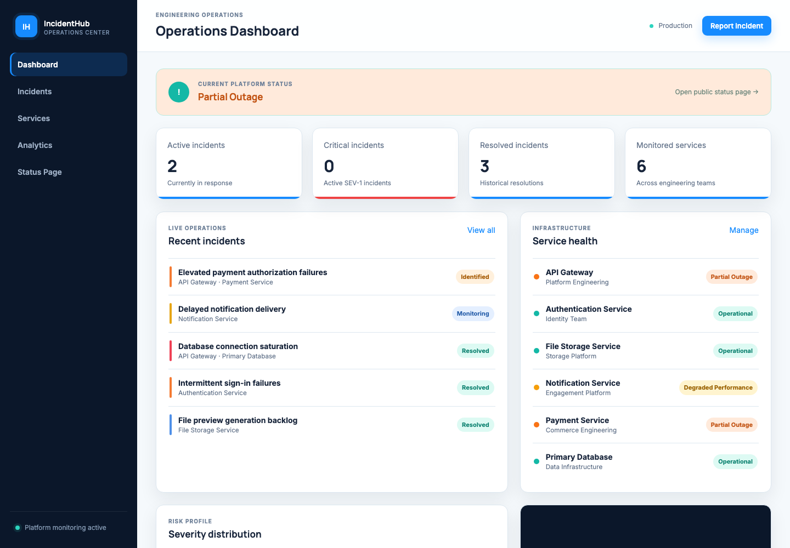
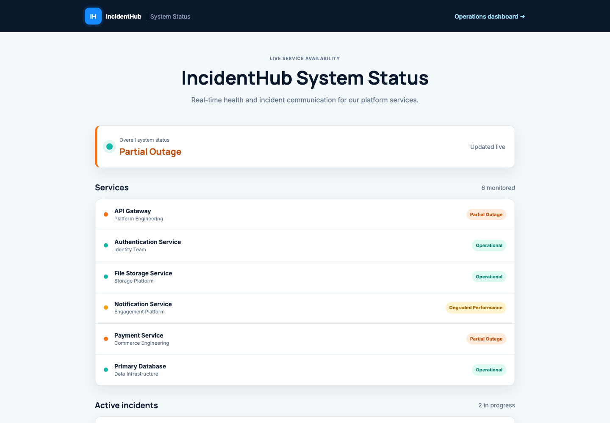
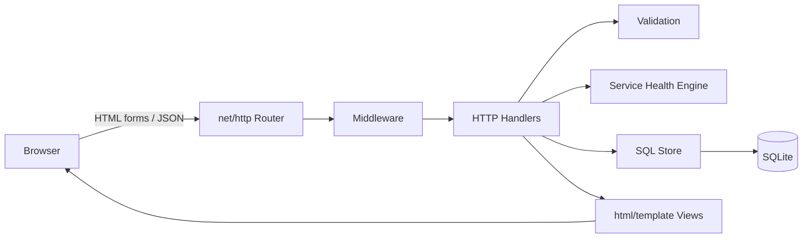
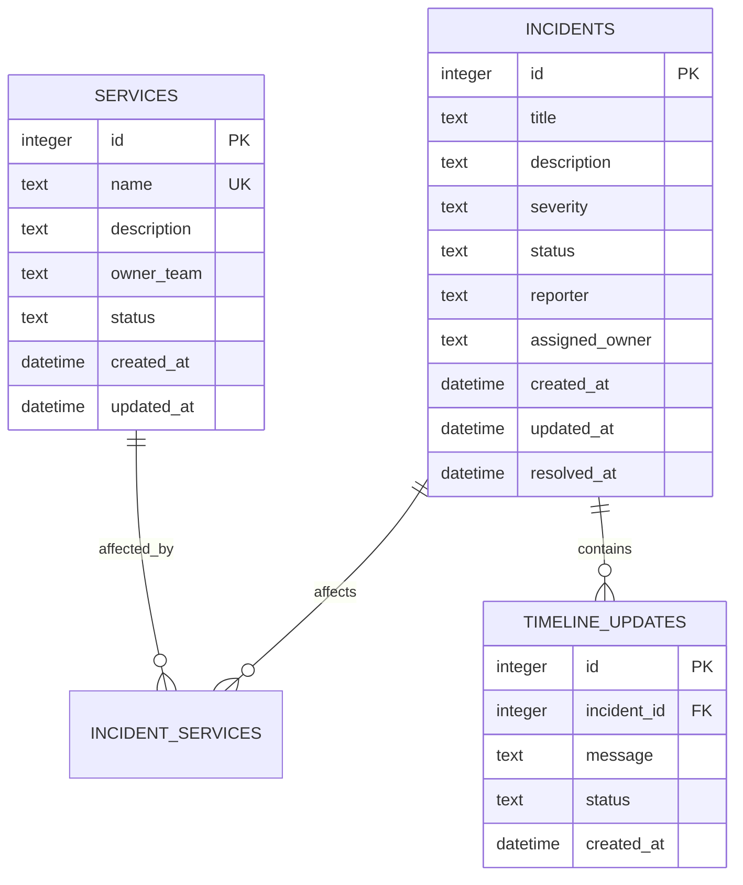

# IncidentHub

IncidentHub is a full-stack software incident management and service status platform
for engineering teams. It provides one place to report outages, coordinate response,
track affected services, communicate progress, and measure operational performance.

The project deliberately uses Go's standard `net/http`, `html/template`, and
`database/sql` packages so the request lifecycle and architecture remain explicit and
easy to discuss in a software engineering interview.

## Problem it solves

Incident response information is often scattered across chat messages, issue trackers,
and monitoring tools. IncidentHub creates a durable operational record while keeping
service health automatically synchronized with active incidents. Responders get an
internal operations dashboard; customers and stakeholders get a clean status page.

## Screenshots

| Engineering operations dashboard | Public system status |
|---|---|
|  |  |

## Major features

- Live dashboard with active, critical, resolved, and monitored-service metrics
- Service catalog with create, view, update, delete, and status filtering
- Incident CRUD with one or more affected services
- SEV-1 through SEV-4 severity model and complete incident lifecycle
- Reporter and owner assignment, resolution timestamps, and incident reopening
- Persistent incident timeline; timeline status updates advance the incident itself
- Automatic service-health engine using the most severe active incident
- Case-insensitive search across title, description, reporter, owner, and service name
- Severity, status, and service filters with newest/oldest/severity sorting
- Analytics calculated from SQLite data, including mean resolution time and trends
- Distinct public status page with service health, active incidents, and recent history
- Read-only JSON endpoints for status, services, and incidents
- Realistic seed data loaded only when the service catalog is empty
- Server-side validation, parameterized SQL, custom error pages, logging, and security headers
- Responsive blue/aqua SaaS interface with minimal JavaScript

## Architecture



The handlers translate HTTP requests into validated domain input. The database package
owns parameterized SQL and transactions. The services package contains testable business
rules such as severity ranking and service-impact calculation. Templates receive view
models rather than executing data access themselves.

## Data model



SQLite foreign keys are enabled. Incident-to-service relationships support multiple
affected services, timeline rows cascade with incident deletion, and services with
incident history are protected from deletion.

## Service health engine

The status is computed in Go from every active incident affecting a service:

| Most severe active incident | Calculated service status |
|---|---|
| SEV-1 Critical | Major Outage |
| SEV-2 High | Partial Outage |
| SEV-3 Medium | Degraded Performance |
| SEV-4 Low | Operational / minor impact |
| No active incidents | Operational |

Resolved incidents are ignored. If multiple incidents are active, the most severe impact
wins. Health is recalculated after creation, editing, resolution, reopening, timeline
status changes, and deletion.

## Tech stack

| Layer | Technology |
|---|---|
| Backend | Go 1.23+, `net/http`, `html/template` |
| Data | SQLite, `database/sql`, `go-sqlite3` |
| Frontend | HTML5, modern CSS, small vanilla JavaScript module |
| Testing | Go `testing`, `httptest`, temporary SQLite databases |
| Operations | Make, Docker, Docker Compose |

Go and HTML are the primary repository languages. JavaScript is limited to responsive
navigation behavior.

## Project structure

```text
incidenthub/
├── cmd/server/main.go          # Application entry point and HTTP server
├── internal/
│   ├── database/               # Schema, seed data, SQL store, analytics
│   ├── handlers/               # HTML and JSON request handlers
│   ├── middleware/             # Logging, recovery, security headers
│   ├── models/                 # Domain models and enums
│   ├── services/               # Severity and service-health engine
│   └── validation/             # Server-side input validation
├── templates/                  # Server-rendered HTML views
├── static/css/                 # Responsive design system
├── static/js/                  # Minimal navigation enhancement
├── docs/screenshots/           # Real application screenshots
├── data/                       # Runtime SQLite database (Git-ignored)
├── Dockerfile
├── compose.yml
├── Makefile
├── go.mod
└── README.md
```

## Installation and local development

Requirements:

- Go 1.23 or newer
- A C compiler for `go-sqlite3` (`clang` on macOS or `gcc` on Linux)

```bash
git clone https://github.com/Azula19-b/incidenthub.git
cd incidenthub
go mod download
go run ./cmd/server
```

Open `http://localhost:8080`. On the first run, IncidentHub creates
`data/incidenthub.db`, applies the schema, and loads realistic services and incidents.
Restarting the app preserves all changes and does not duplicate the seed records.

Optional environment variables:

| Variable | Default | Purpose |
|---|---|---|
| `ADDR` | `:8080` | Server listen address |
| `DATABASE_PATH` | `data/incidenthub.db` | SQLite database location |

## Docker

```bash
docker compose up --build
```

The database is stored in the named `incidenthub-data` volume. Stop the stack with
`docker compose down`. Add `-v` only when you intentionally want to delete all local data.

## Build and test

```bash
go test ./...
go vet ./...
go build -o bin/incidenthub ./cmd/server
```

Or run all checks:

```bash
make check
```

The tests cover severity mapping, multiple simultaneous incidents, calculated service
health, incident and service validation, case-insensitive search, filtering, all sort
orders, database analytics, seeded data, major HTML routes, form errors, and custom 404s.

## Routes

### HTML application

| Method | Route | Purpose |
|---|---|---|
| `GET` | `/` | Operations dashboard |
| `GET` | `/services` | Service list and status filter |
| `GET/POST` | `/services/new`, `/services` | Service form and creation |
| `GET/POST` | `/services/{id}`, `/services/{id}` | Service detail and update |
| `POST` | `/services/{id}/delete` | Delete an unused service |
| `GET` | `/incidents` | Searchable/filterable incident list |
| `GET/POST` | `/incidents/new`, `/incidents` | Incident form and creation |
| `GET/POST` | `/incidents/{id}`, `/incidents/{id}` | Incident detail and update |
| `POST` | `/incidents/{id}/timeline` | Add update and change lifecycle state |
| `POST` | `/incidents/{id}/delete` | Delete an incident and its timeline |
| `GET` | `/analytics` | Database-backed analytics |
| `GET` | `/status` | Public system status page |
| `GET` | `/healthz` | Process health check |

### JSON API

| Method | Route | Query options |
|---|---|---|
| `GET` | `/api/v1/status` | Overall status, services, active and recent incidents |
| `GET` | `/api/v1/services` | `status` |
| `GET` | `/api/v1/incidents` | `q`, `severity`, `status`, `sort` |

Example:

```bash
curl 'http://localhost:8080/api/v1/incidents?q=payment&severity=SEV-2&sort=severity-desc'
```

## Engineering and security choices

- Every SQL value is passed as a parameter; sort clauses come from a fixed allowlist.
- All important form fields are validated again on the server.
- Go templates escape untrusted HTML by default.
- HTTP method-aware routes return `405 Method Not Allowed` for unsupported methods.
- Foreign keys and transactions keep incident, service, and timeline state consistent.
- CSP, clickjacking, MIME-sniffing, and referrer headers are set by middleware.
- Panics are recovered and logged instead of terminating the process.
- Server timeouts and a SQLite busy timeout protect basic resource usage.
- Runtime databases, binaries, logs, local environment files, and OS metadata are ignored.

## Future improvements

- Authentication, RBAC, and an immutable audit log
- CSRF tokens for deployments with authenticated browser sessions
- Pagination for large incident histories
- Webhook, email, and chat notifications
- Maintenance windows and subscriber notifications
- PostgreSQL adapter for horizontally scaled deployments
- OpenTelemetry tracing and Prometheus metrics

## Resume-ready description

> Built a full-stack incident management and service monitoring platform using Go,
> HTML, and SQL, implementing REST-style APIs, multi-service incident lifecycle tracking,
> automatic service-health calculations, timeline communication, analytics,
> search/filtering, and persistent SQLite storage.

## Known limitations

IncidentHub intentionally does not include authentication so the portfolio project can
focus on incident operations and data integrity. Before an internet-facing deployment,
add user accounts, role-based authorization, and CSRF protection. SQLite is ideal for a
single-node demo or internal tool; a multi-instance deployment should use PostgreSQL.
